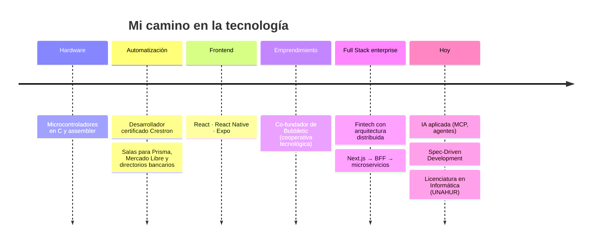
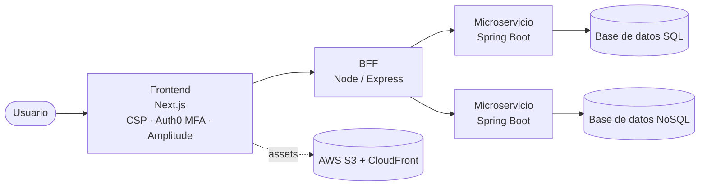

# Hola, soy Cristian Martinez

**Full Stack Developer** · React / Next.js · Node.js · Spring Boot 
📍 Buenos Aires, Argentina · 🌎 Abierto a oportunidades remotas

---

## 🧭 Del hardware al software

Llegué al software desde el hardware. Este es el recorrido:

---

## 🚪 Elegí tu camino

<b>👔 Soy recruiter: dame el resumen en 30 segundos</b>

 

- **Perfil:** Full Stack Developer con más de 5 años de experiencia, con fuerte peso en frontend y en crecimiento constante en backend y arquitectura.
- **Experiencia más fuerte:** plataforma fintech distribuida, en un ecosistema de ~5 equipos.
- **Busco:** rol full stack, remoto, en relación de dependencia.
- **Diferencial:** vengo del hardware y la automatización, así que entiendo los sistemas de punta a punta.
- **Extra:** co-autor de una nota de investigación publicada por la American Astronomical Society.

<b>💻 Soy dev: mostrame la arquitectura y el código</b>

 

### Experiencia destacada: Full Stack Developer en Nera (fintech)

- Implementé **Content Security Policy (CSP)** en el frontend como respuesta a una auditoría de seguridad bancaria.
- Integré **MFA con Auth0** en el flujo de autenticación.
- Integré métricas de producto con **Amplitude**.
- Desarrollé cambios **end-to-end** atravesando base de datos → microservicio → BFF → frontend.
- Trabajé con persistencia en bases de datos **SQL y NoSQL** desde los microservicios.
- Trabajé con **AWS S3 + CloudFront**, deploy con **nullplatform** y **CI/CD en GitHub**.

### Proyectos

| Proyecto | Descripción | Stack |
|---|---|---|
| **tool-init** | CLI zero-dependency para scaffolding de proyectos con un sistema de orquestación de cuatro roles. | Node.js (ESM) |
| **Racing MCP Server** | Servidor MCP que expone datos de Racing Club a asistentes de IA. | Node.js · MCP |
| **Domótica con IA** | App propia para controlar luces, relés, infrarrojos y Google Home con lenguaje natural. | IoT · IA |
| **La Granja de Atahualpa** | Juego desarrollado en equipo (Cyberobjeto) con Wollok Game, en el paradigma de objetos. | Wollok |
| **Websockets Chat** | Chat web en tiempo real. | React · Express · Socket.io |

<b>🔭 Soy curioso: contame del exoplaneta</b>

 

**A Neptune-size Planet Candidate in a 2.77 days Orbit Around TYC 8996-1013-1** 
*Research Notes of the AAS* · Enero 2025 · [DOI 10.3847/2515-5172/ada615](https://doi.org/10.3847/2515-5172/ada615)

Analizamos datos del satélite **TESS** con Python (Astropy, Lightkurve, Juliet). La idea es simple: cuando un planeta pasa delante de su estrella, el brillo que medimos baja un poquito. Ese "pozo" en la curva de luz, repetido cada 2,77 días, delata a un candidato del tamaño de Neptuno.

---

## 🛠️ Stack

**Frontend** 

**Backend** 

**Datos** 

**Cloud, DevOps y herramientas** 

---

## ⚡ Ahora mismo

- 🏗️ Profundizando en arquitectura de software y backend para ser un full stack cada vez más completo.
- 🤖 Construyendo herramientas con IA aplicada (MCP, agentes).
- 🎓 Avanzando en la Licenciatura en Informática (UNAHUR).
